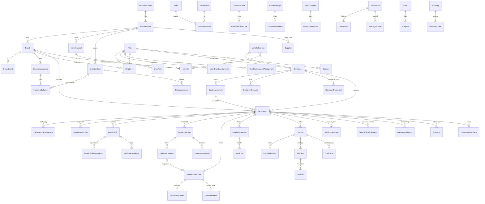

# Database design

PostgreSQL 17, schema in `prisma/schema.prisma`, migrations in `prisma/migrations` (the source of truth — never create tables by hand). 70+ models; UUID primary keys; human-facing numbers come from `NumberSequence`.

## Relationship diagram (core)

## Integrity rules enforced by the database

Hand-written SQL appended to the initial migration:

| Rule | Mechanism |
|---|---|
| Stock never negative; reserved ≤ on hand | `CHECK` on `InventoryBalance` |
| Positive quantities / amounts; rating 1–5; min ≤ max durations; no self-dependency | `CHECK` constraints |
| One spare-part issue per request (no duplicate issues) | `UNIQUE (SparePartIssue.requestId)` |
| One reservation per request | `UNIQUE (StockReservation.sparePartRequestId)` |
| A vehicle in at most one live booking | partial unique index |
| One non-cancelled invoice per service job | partial unique index |
| Finalized invoice amounts/number/lines immutable; cancelled can't reopen; non-draft can't be deleted | triggers `oxina_protect_finalized_invoice*` |
| Audit log, stock ledger, customer approvals, customer timeline, credit notes are append-only | trigger `oxina_block_mutation` |
| Unique VIN / engine number / registration / document numbers; unique part number per business unit | unique indexes |

## Other conventions

* **Branch scoping** — every operational table carries `branchId` (indexed together with status/date). Customers are group-wide; staff see a customer if created at, or transacting with, one of their branches.
* **No destructive cascades** on operational/financial history — relations use `onDelete: Restrict`; users, branches, units, employees and items are *deactivated*, never deleted. Only ephemeral auth rows (sessions, reset tokens) cascade.
* **Money** `Decimal(14,2)`; tax rates `Decimal(5,2)`; quantities are integers in the item's base unit (pcs, ml…).
* **Time** `timestamptz` (UTC); branches carry `timezone`, working hours/days and holidays for display and ETA.
* **Settings** — `BranchSetting` → `BusinessSetting` → built-in defaults (`src/lib/services/settings.ts`).
* **Inventory available quantity** = `quantityOnHand − quantityReserved`, never stored separately.
